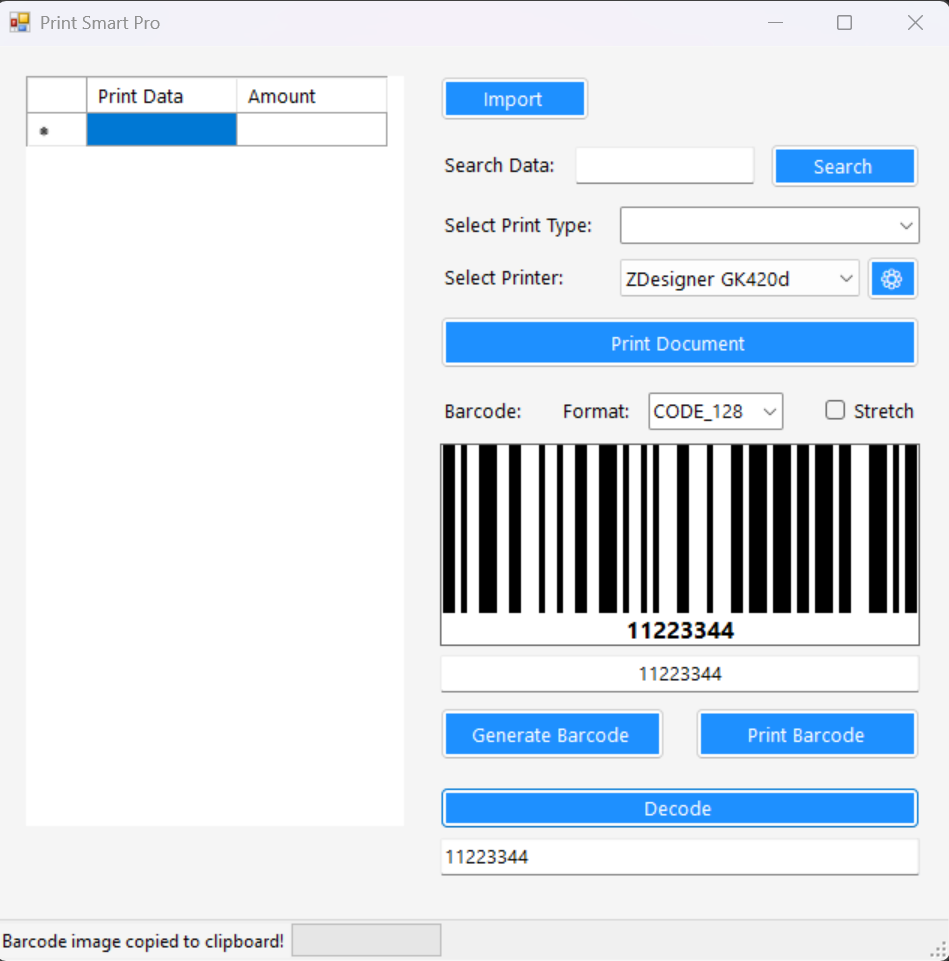
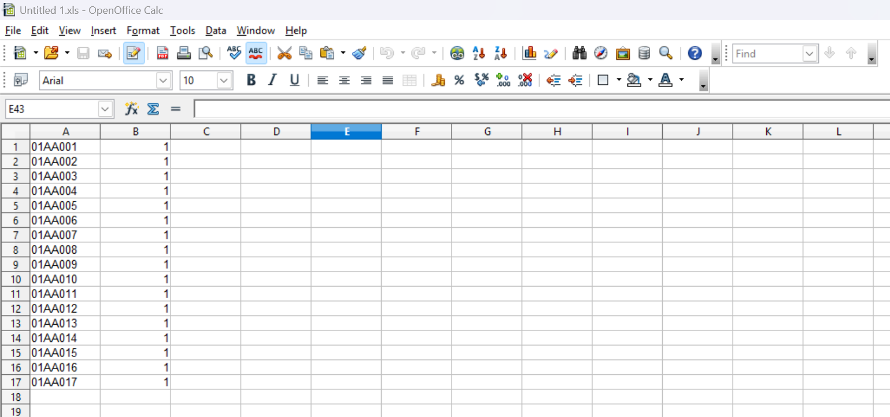

# PrintSmartPro

**Barcode Generator & Batch Excel Label Printing Utility**  
*Developed by [Biohazard Corp](https://biohazard-corp.nl) ([@Creator-NL](https://github.com/Creator-NL))*

[](LICENSE)
[](#getting-started)
[](#getting-started)

---

## Overview

**PrintSmartPro** is a fast, lightweight Windows desktop utility for generating barcodes and batch-printing barcode documents or thermal labels directly from Excel / spreadsheet clipboard data.

Whether you need to generate a single barcode and copy it to your clipboard in one click, or batch-print hundreds of warehouse product labels and A4 barcode sheets from an Excel list at once, **PrintSmartPro** streamlines the entire workflow without bloated software or cloud dependencies.



---

## Key Features

- **Batch Excel / Spreadsheet Printing:**
  - Copy 1 or 2 columns (`Print Data` and `Amount`) directly from Microsoft Excel or any spreadsheet and click **Import**.
  - Built-in grid search (`Search Data`) to quickly locate specific items (such as PZN codes, SKUs, or warehouse locations) before printing.
  - Confirmation prompt before dispatching large batch print jobs.
- **Multi-Format Barcode Generator & Decoder:**
  - Generate crisp barcodes using [ZXing.Net](https://github.com/micjahn/ZXing.Net):
    - `CODE_128`
    - `CODE_39`
    - `QR_CODE`
    - `EAN_13`
    - `UPC_A`
    - `DATA_MATRIX`
  - **One-Click Copy:** Click the generated barcode preview image to copy it directly to your Windows clipboard.
  - **Built-in Decoder:** Verify and decode generated barcodes directly inside the app.
- **Multiple Print Layouts & Templates:**
  - **GK420d Big Label:** Formatted specifically for industrial thermal label printers like the **Zebra GK420d**.
  - **A4 Barcode:** Standard A4 barcode document sheets for laser/inkjet office printers.
  - **A4 Product Manipulation:** Structured A4 warehouse/logistics sheets for inventory and product handling.
- **Direct Printer & Driver Control:**
  - Select any installed Windows printer on the fly and open its native driver preferences (`⚙️`) with a single click.

---

## Supported Hardware & Printers

- **Thermal Label Printers:** Tested and optimized for **Zebra GK420d** (`ZDesigner GK420d` driver).
  - *Tip for Zebra GK420d users:* In **Printing Preferences > Dithering**, set Dithering type to **None** for the sharpest barcode edges.
- **Standard Office Printers:** Any Windows-compatible A4 laser or inkjet printer, plus **Microsoft Print to PDF**.

---

## How to Batch Print from Excel

1. In Excel, LibreOffice Calc, or OpenOffice, arrange your data in up to **2 columns** (do not include headers when selecting):
   - **Column 1 (`Print Data`):** The barcode value, SKU, PZN, or location code.
   - **Column 2 (`Amount`):** Number of copies to print for that row *(optional — defaults to 1 copy if omitted)*.



> A ready-to-use sample spreadsheet is included in the repository: [`examples/Data.xls`](examples/Data.xls).

2. Select the cells and copy them (`Ctrl + C`).
3. Click **Import** in **PrintSmartPro**.
4. Choose your **Print Type** (`A4 Barcode`, `A4 Product Manipulation`, or `GK420d Big Label`).
5. Select your target **Printer** and click **Print Document**.

---

## Getting Started & Building from Source

### Prerequisites
- Windows 10 or Windows 11
- [Visual Studio 2022](https://visualstudio.microsoft.com/) (with **.NET desktop development** workload)
- .NET Framework 4.8

### Clone & Compile
```powershell
git clone https://github.com/Creator-NL/PrintSmartPro.git
cd PrintSmartPro
```
1. Open `PrintSmartPro.sln` in Visual Studio 2022.
2. Restore NuGet packages (`ZXing.Net`).
3. Build and run (`F5` or **Build > Build Solution**).

---

## Official Links & Support

- **Official Website:** [https://biohazard-corp.nl](https://biohazard-corp.nl)
- **GitHub Profile:** [@Creator-NL](https://github.com/Creator-NL)
- **Sponsor / Donate:** [PayPal (@biohazardcorp)](https://paypal.me/biohazardcorp)
- **Contact:** `contact@biohazard-corp.nl`

---

## License

Distributed under the **MIT License**. See [`LICENSE`](LICENSE) for full details.
